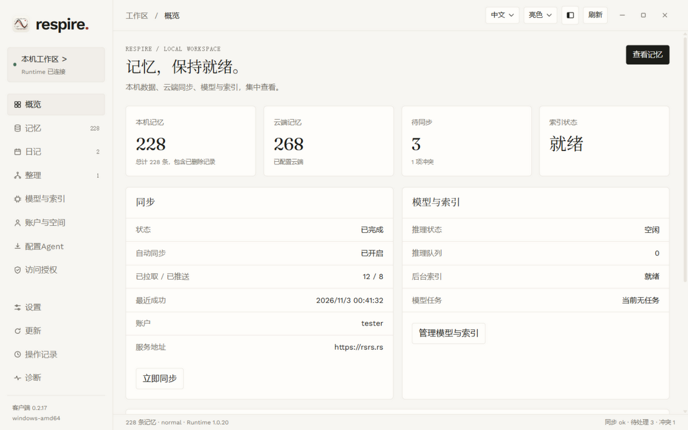
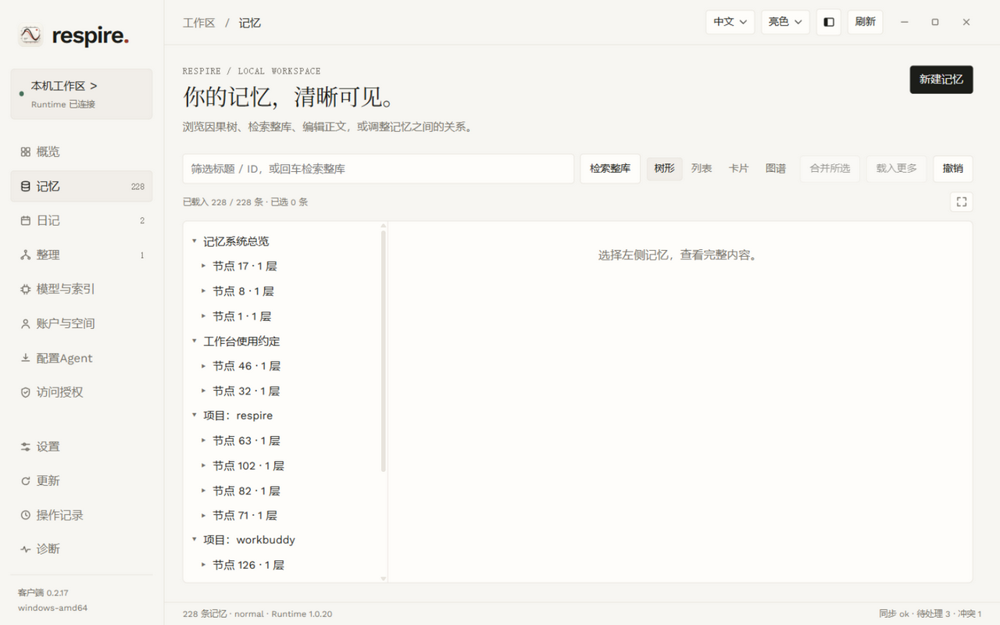
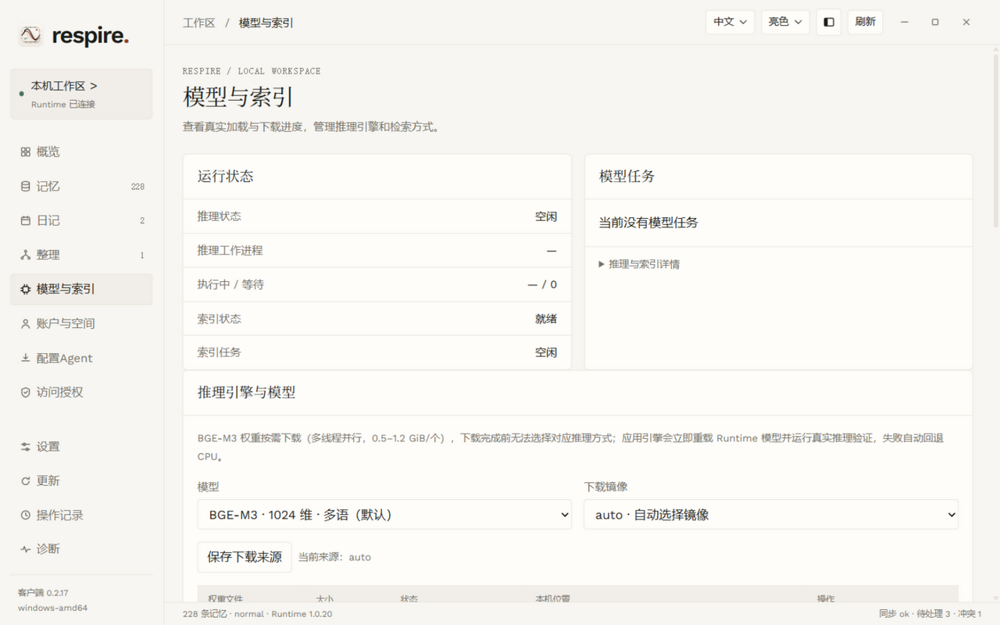
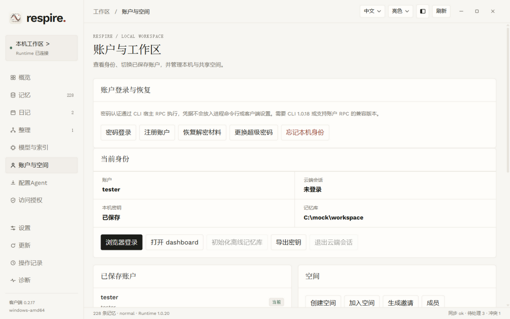
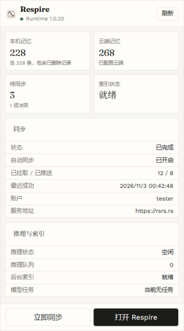

# Respire 客户端 2

[English](README.md) | 简体中文

基于 Wails v3 与 Go 构建的 Windows、macOS、Linux 桌面客户端，用于替代 `risense-ai/respire-client` 中的桌面应用。CLI、TUI、托管 Dashboard 以及既有用户数据保持独立。

从 [Releases](https://github.com/risense-ai/respire-client2/releases) 下载与操作系统和架构匹配的产物。请将解压后的应用保存在可写入的固定目录。Windows 为单个 EXE，需要 Microsoft Edge WebView2；macOS 为压缩的 `Respire.app`；Linux 为包含单个可执行文件的 tarball，需要 GTK 3、WebKitGTK 4.1 和 X11 库。最终用户无需安装 Node.js、Go、npm 或 Rust。应用在可用时单独下载 CLI 及其原生库；本体不包含 Core 与模型权重。若不存在客户端管理的 CLI，客户端可识别并启动 `<root>/bin/rsrs[.exe]` 处的外部 CLI，包括 npm 安装的版本。

架构、原生库前置条件，以及桌面构建与 CLI 可用性的差异见[平台支持](docs/platforms.md)。缺失的 CLI/Core 发布目标记录在 [respire-cli#163](https://github.com/risense-ai/respire-cli/issues/163)。

## 界面截图

| 概览 | 记忆 |
| --- | --- |
|  |  |

| 模型与索引 | 账户与空间 |
| --- | --- |
|  |  |

托盘快捷面板：



## 当前功能范围

- 原生托盘，点击打开快捷面板（本地/云端记忆条数、待同步与索引状态、最近同步成功时间、账户、服务器地址、推理队列与模型任务）；单实例运行，关闭即收敛到托盘，`--tray` 随系统登录启动。
- 侧栏布局或紧凑顶部导航，亮色 / 暗色 / 跟随系统主题并跨重启保存。随附的亮/暗图标会跟随界面、托盘与原生窗口的主题。
- Dashboard 排版与纸白/炭黑配色，内置字体供离线使用并附带授权文件。
- 通过本机回环 HTTP RPC 读取 Runtime 健康状态、记忆条数、同步、模型任务、推理队列与检索索引状态。
- 记忆树形/列表视图、完整阅读、语义召回、新建/编辑、移动、合并、删除/恢复、因果链与子树分享。合并遵循 CLI 契约：存留子节点提升到存留祖先之下。
- 日记日历与片段检索；整理建议、相似检查、结构审计、本地修复预览、经校验的移动方案与可选 AI 分类。
- 模型/索引准备、取消/重启、推理引擎与权重文件选择、提供方安装、召回服务配置，以及带九轮 Benchmark 的本地/高质量召回验证。
- 账户、浏览器登录、离线初始化、空间、迁移、同步设置、注入目标、原生文件选择与导入/导出/备份。
- 首次运行下载 Runtime，SHA-256 校验、有界解压、完整原生库校验、启动/停止与版本更新。
- 通过 Wails 更新器检查并下载客户端更新。已下载的客户端更新由「重启并应用」生效；更新桌面不会停止 Runtime。
- CLI 与客户端各自独立的 Stable / Dev 通道、偏好设置、请求 ID 保留与明确的未知结果处理。
- 图谱支持缩放/平移、键盘导航、拖拽、目录筛选、节点链接与符合条件的末次操作撤销。撤销会拒绝已变化的记忆库；它不是原子化的跨客户端事务。
- 系统字体枚举、界面缩放与阅读排版持久化；默认可执行文件/应用包图标使用亮色图标。
- 只读子树授权（含直接/继承查看与撤销）、空间成员管理、记忆材料导出与永久密文清除。
- 密码/TOTP登录、注册、密钥恢复与超级密码重置，经版本化的 CLI 宿主 RPC 完成；需要兼容的 CLI 包。见[传输与验收状态](docs/cli-host-input.md)。

`v0.2.2` 版本可识别 `<root>/bin/rsrs[.exe]` 处已有的外部 CLI，读取并显示其版本，且可在不接管 npm 归属的情况下启动它。更新页提供 GitHub 与国内镜像链接，供手动下载桌面端与 CLI。桌面更新自动下载，下载完成后自动重启应用；业务操作或任务执行期间除外。新安装默认 CLI 与客户端均使用 Stable；既有安装保留所选通道。若只想接收稳定版，请在更新页将两个通道都选为 Stable。[Releases](https://github.com/risense-ai/respire-client2/releases) 列出可用构建。已验证路径与发布门槛见[验证记录](docs/verification.md)与[迁移验收](docs/migration.md)。

## 仓库结构

```text
main.go                               入口与无界面诊断
internal/
  desktop/
    app.go                            Wails 生命周期、单实例、托盘、调度
    api.go                            WebView 内 HTTP 动作；不监听公共 HTTP 端口
    updates.go                        Wails 客户端更新器与强制校验和策略
    appearance*.go                    主题解析与原生窗口/托盘图标
    business.go, files.go              具名业务动作与原生文件对话框
    frontend/workspace.html           内嵌入口；无前端构建依赖
    frontend/client.js, ui/           路由、状态轮询与 UI 辅助
    frontend/pages/                   Runtime、账户、设置与整理视图
    frontend/memory/                  树形/列表、编辑器、日记与记忆关系
    frontend/fonts/                   Dashboard 字体与再分发授权
    build/icon*.png                   亮/暗原生图标
  host/
    manager.go                        安装根目录、偏好、原子 JSON、任务状态
    rpc.go                            有界回环传输与诊断命令
    lifecycle.go                      宿主启动、停止、版本选择与恢复
    process_{windows,linux,darwin}.go  操作系统相关的进程标识与退出等待
    platform.go                       资产命名、CLI 目标与 PE/Mach-O/ELF 校验
    releases.go                       官方 CLI 发布发现与受检下载
    install.go                        安全解压、库校验、切换与恢复
    commands_*.go                     按业务领域显式列出的操作/参数白名单
    operations.go                     异步 RPC 请求、回执与恢复
    host_operations.go                经验证的 CLI 宿主动作；API 密钥经 stdin 传入
build/winres.json                     EXE 图标、版本与 Windows 清单
scripts/build.ps1                     Windows x64/ARM64 构建与校验和
scripts/build.sh                      macOS/Linux 原生构建与打包
scripts/release-notes.sh              标签发布说明及可直接复制的用户公告块
.github/workflows/desktop.yml         按平台的 CI 产物与标签发布
```

依赖方向为 `main → desktop → host`。host 包不导入 Wails。前端只调用具名桌面动作；不执行命令、不打开数据库、不加载 Core、不调用云端 API。记忆、同步与模型操作走 RPC。经验证的 CLI 子进程处理属于宿主的操作，包括浏览器授权、账户切换、注入与密钥库配置。

Go 模块名为 `respire-client2`。引用本仓库自己的包时使用 `respire-client2/internal/...`；不要使用带域名的模块名或 `./` 导入。第三方依赖保留官方模块路径。

CLI 显示语言是宿主偏好：CLI 本身没有语言命令/RPC。桌面端遵循其 `client.json` 的 `lang` 契约，保留其他键，并在所选安装根目录下原子写入。记忆与账户数据仍由 Runtime/CLI 管理。

新的 Runtime 操作放在 `host`，桌面集成放在 `desktop`，渲染放在 `frontend`。新增窄接口动作，而不是提供任意 shell/CLI 执行端点。错误处理留在拥有该操作的层。不要添加第二个更新器、独立的生命周期协调器，或前端复刻的 Runtime 业务规则。

## 构建

Go 1.26+、Node.js 22+（仅语法检查）。Windows 使用 PowerShell：

```powershell
powershell -NoProfile -ExecutionPolicy Bypass -File scripts/build.ps1 -Version 0.2.0 -Arch amd64
```

`-Arch` 接受 `amd64` 或 `arm64`。资源生成器运行在构建机的架构上；应用按请求的架构构建。产物为 `dist/respire-windows-<arch>.exe`、`dist/SHA256SUMS`、`dist/LICENSE.txt` 与 `dist/THIRD_PARTY_NOTICES.txt`。

macOS（Xcode Command Line Tools）或 Linux（C/C++ 编译器、pkg-config、GTK/WebKit 开发库）：

```sh
bash scripts/build.sh 0.2.0 amd64  # 对应原生运行器上也可用 arm64
```

Linux 构建使用 Wails 的 `gtk3` 标签并链接系统 GTK 3 与 WebKitGTK 4.1。CI 在原生运行器上构建各架构。macOS 打包会生成应用图标并施加 ad-hoc 签名，这不是 Apple Developer ID 签名，也不是公证。

第三方声明内嵌在可执行文件中，并随发布产物一同提供。依赖与构建缓存放在 `.tools/` 下。构建脚本会运行 `go vet` 与前端语法检查（Node 可用时）；CI 的原生任务始终包含 Node。Windows 资源生成无控制台窗口的 GUI 可执行文件。不要提交缓存、二进制、生成的 `.syso` 文件或验证数据。

隔离运行时，使用专用根目录与未占用端口：

```powershell
$env:RSRS_DATA_DIR = Join-Path $PWD '.verification\profile'
$env:RSRS_RPC_PORT = '19169'
Start-Process -FilePath (Join-Path $PWD 'dist\respire-windows-amd64.exe') -WindowStyle Hidden
```

安装/更新验证不要使用真实用户目录。首次启动可下载当前官方 CLI 包。桌面退出时，正在运行的 Runtime 会有意保留存活。

## 本地布局与归属

安装根目录为 `~/.rsrs`，或既有的 `RSRS_DATA_DIR` 覆盖。客户端自有文件位于 `<root>/client2/`：

```text
preferences.json          自动连接与自动更新偏好
requests.json             仅写请求 ID/状态；不含参数、密钥或记忆正文
runtime.json              当前托管版本与可执行文件 SHA-256
runtime/<version>/        不可变 CLI、core-runtime.json、原生库与声明文件
webview2/                 WebView2 浏览器配置
client.log                桌面运行错误
```

当 `<root>/client2/runtime.json` 不存在时，客户端也识别 `<root>/bin/rsrs[.exe]` 处的外部可执行文件。它会校验可执行文件架构并读取 `--version`；不会接管该外部 CLI 的归属或自动更新它。

`RSRS_RPC_PORT` 覆盖 `15169`。RPC 保持 `127.0.0.1` 上的 HTTP；客户端不更改 Runtime 的绑定地址、认证策略或 Origin 检查。已安装的 CLI 宿主动作会收到指向其完整版本目录的 `RSRS_BIN_DIR`，避免 CLI 脱离配套库单独落地 EXE。

已在运行的兼容 Runtime 会被直接附加而不会替换。自动更新只停止可执行文件位于本客户端托管目录内的 Runtime。由其他 CLI 启动的 Runtime 仍归该 CLI 所有；安装托管 Runtime 前请先显式停止它。其他宿主 CLI 仍可按其各自的版本策略接管共享的 Runtime 端点。本客户端不会修改那些 CLI，也不承诺独占 15169 端口。

登录启动通过 Wails 注册当前应用：Windows 按用户登录项、macOS 登录项/LaunchAgent、Linux XDG autostart。移动或删除应用会使注册失效；移动后请关闭再重新开启该开关。窗口关闭按钮隐藏窗口。托盘的退出动作只退出桌面。Linux 托盘需要桌面环境支持 StatusNotifierItem；部分 GNOME 安装需要 AppIndicator 扩展。

## 更新契约

### 桌面客户端

来源：`risense-ai/respire-client2` 的 GitHub releases。Stable（默认）使用最新稳定版；Dev 包含已发布的预发布版。每个发布必须包含：

```text
respire-windows-<arch>.exe    # Windows: amd64, arm64
respire-darwin-<arch>.zip     # macOS: amd64, arm64；单个 .app 包
respire-linux-<arch>.tar.gz   # Linux: 单个 respire 可执行文件
SHA256SUMS
LICENSE.txt
THIRD_PARTY_NOTICES.txt
```

`SHA256SUMS` 对每个平台产物使用标准 `hex-digest  filename` 行。更新器精确匹配正在运行的操作系统/架构，并拒绝缺失或无效的 SHA-256 校验和。下载暂存、解压与基于 helper 的替换/重启恢复由 Wails 完成；macOS 替换完整应用包。helper 从同一应用内重新执行：不单独分发更新器。自动检查在启动后及每六小时运行；下载先暂存，再由用户重启生效。空仓库/未发布仓库无法提供生产更新，并会在更新面板中报告。

初始版本使用 HTTPS GitHub release 元数据与 SHA-256。未实现发布者密钥签名或 Authenticode 签名。同一发布源提供的哈希无法防御该源被攻破。在更改该信任假设之前先增加发布签名；不要静默绕过失败的校验。

### Runtime

来源：`risense-ai/respire-cli` 已发布的 release。Stable（默认）使用 GitHub 最新稳定版。Dev 在最近 20 个已发布版本（含预发布）中选择最高语义版本。各平台映射的目标必须提供（以上述 Windows amd64 为例）：

- `cli-build-x86_64-pc-windows-msvc.json`，含 schema 1、版本、目标、源码提交与两个产物哈希。
- `rsrs-x86_64-pc-windows-msvc.exe`。
- `rsrs-x86_64-pc-windows-msvc-runtime.tar.gz`，含 `core-runtime.json` 与全部声明的原生库/声明文件。

下载暂存在托管 Runtime 目录下。归档链接、特殊文件、路径逃逸、超大归档与不匹配的文件哈希都会被拒绝。不覆盖正在运行的 EXE 或 DLL。校验通过后发布版本目录，优雅停止当前托管 Runtime，原子保存所选版本指针，并通过既有宿主路径启动新 CLI。其健康版本与可执行路径必须匹配。启动失败会恢复上一个所选版本并尝试再次启动。旧版本目录保留用于恢复；清理刻意延后。

PE、Mach-O 或 ELF 头必须匹配正在运行的操作系统与架构；Unix 可执行权限予以保留。缺失目标会直接报告，不会替换或模拟其他 CLI 架构。Linux 生命周期管理使用 pidfd，需要内核 5.3+；macOS 在等待退出前检查可执行路径与进程启动时间。

RPC 工作正在执行或排队时推迟自动切换；检查在下载后运行，完整下载的版本会保留到下次尝试。Runtime 自行负责排空其写入与后台任务。停止会等待进程经验证退出，从不强杀。若停止或重启无法确认，错误保持可见。二进制回滚不保证回滚未来 CLI 迁移过的数据库模式；此类发布在自动分发前需要单独的兼容性/迁移策略。

两个通道选择与布局彼此独立，持久化在 `preferences.json`。切换通道只保存策略；不中断进行中的操作，也不自动降级已安装版本。若已安装的 Dev 版本高于 Stable，它会保留安装直到 Stable 追上。更改客户端通道前，先应用已下载的客户端更新。Runtime 任务执行期间禁用通道切换。新的原生/RPC 操作必须遵守这些规则。

RPC 要求协议 `v = 1`。业务动作使用白名单化的 `cli.exec` 参数；模型/索引准备与恢复使用 Runtime 方法 `model.prepare`、`model.control`、`index.prepare` 与 `runtime.result`。不支持的命令与方法保持为可见错误。当前业务 UI 以 CLI `1.0.17-dev.14` 完成验证；不要假定稳定版 CLI 具备全部可选功能。

写入只保留一个请求 ID。回执丢失会触发对原始请求的查询，绝不自动重放。完整写入回执在会话期间保留在内存中；重启后仅保留元数据。经验证的 CLI 在内存中保留最近 64 个已完成请求；被驱逐的回执或重启后的 Runtime 可能结果未知，这不能证明其写入未提交。结果未知的宿主动作必须在对应页面复核，因为 Runtime 无法恢复宿主进程的回执。配置错误与缺失模型文件会直接显示。

## 发布

分支与拉取请求构建上传各平台产物但不发布。推送 `vX.Y.Z` 标签会运行同一构建矩阵，合并全部校验和，并且只在所有必需构建成功后创建一个 GitHub release。形如 `vX.Y.Z-dev.N` 的标签为 Dev 通道发布预发布版，不会被稳定版更新器选中。发布工作流使用仓库范围内的 `GITHUB_TOKEN`；源码中不包含账户凭据。

首个发布必须显式发布后，公开自更新才能工作。本地构建不会发布、推送、安装登录项或替换用户的 Runtime。

每个标签发布都会生成两部分的 `.release-notes.md`：提交变更日志，以及一个以面向用户的中文写成的「更新说明」围栏块（纯文本主题、下载链接、按类别分列的要点）。向用户公告时原样复制该围栏块；不要贴原始 commit 主题或链接。面向用户的措辞放在该块中，而不是 commit message 里。

## 诊断

同一 EXE 支持通过重定向 stdout 输出 JSON，用于支持与自动化：

```powershell
& .\dist\respire-windows-amd64.exe --headless status
& .\dist\respire-windows-amd64.exe --headless rpc-status
& .\dist\respire-windows-amd64.exe --headless runtime-release
& .\dist\respire-windows-amd64.exe --headless install-runtime
& .\dist\respire-windows-amd64.exe --headless start
& .\dist\respire-windows-amd64.exe --headless stop
```

`status`、`rpc-status` 与 `runtime-release` 不会启动或替换 Runtime。安装/启动/停止是显式宿主动作；验证时务必设置隔离的根目录与端口。错误查看 `client.log` 与诊断面板。生产 UI 不展示任何兜底 mock。

## 参考与许可

已验证路径与限制见[本地基础验证](docs/verification.md)，本版本之后的完整客户端迁移见[交付范围](docs/roadmap.md)。

Wails 提供桌面、自启动与客户端更新机制。Runtime/Core/模型文件保留其各自的再分发声明。第一方条款见 [LICENSE](LICENSE)。
